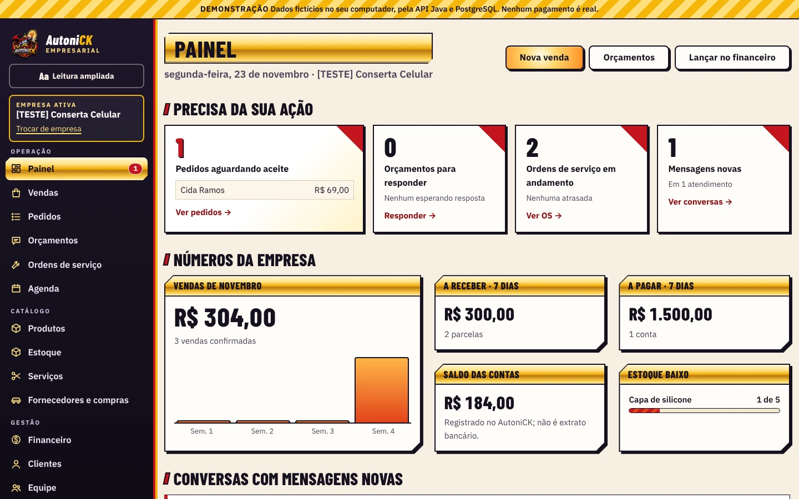
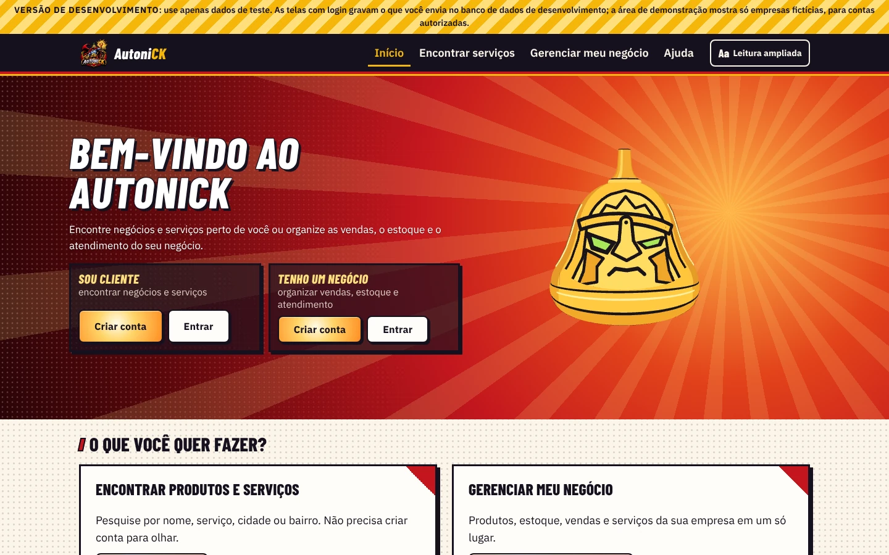
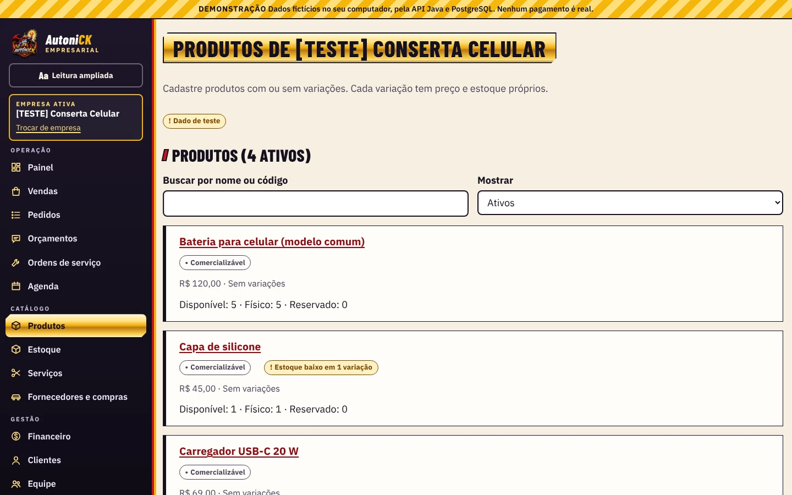
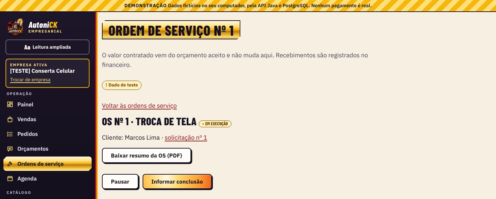
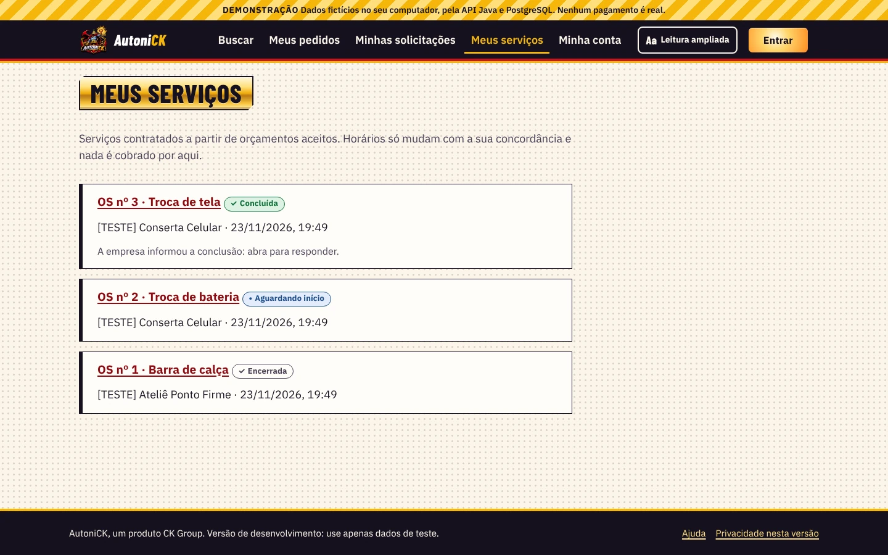
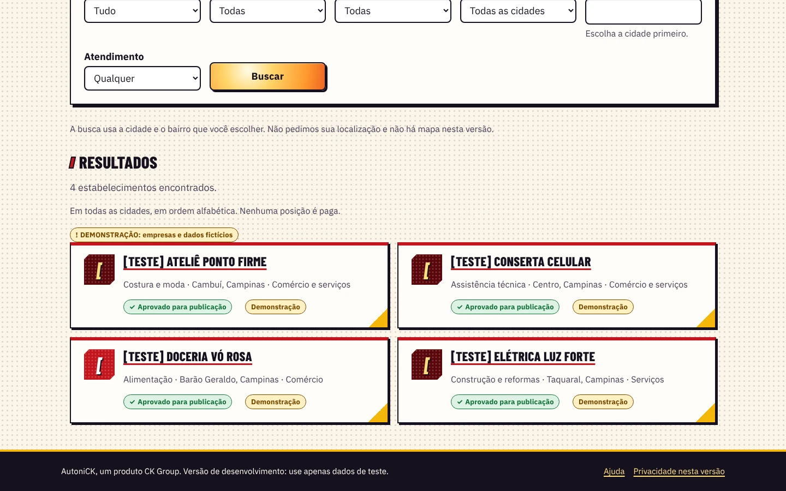
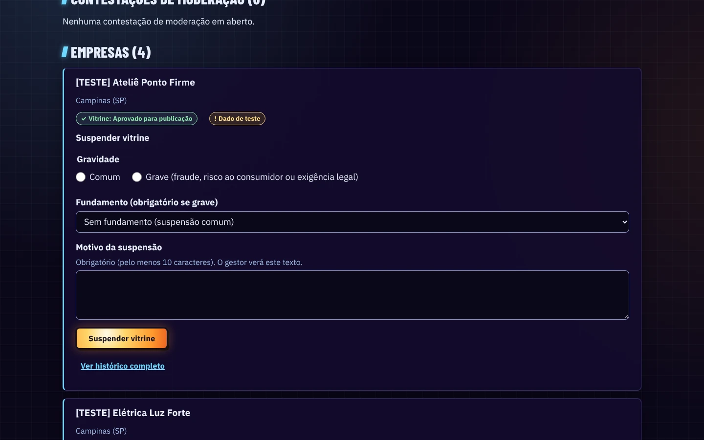
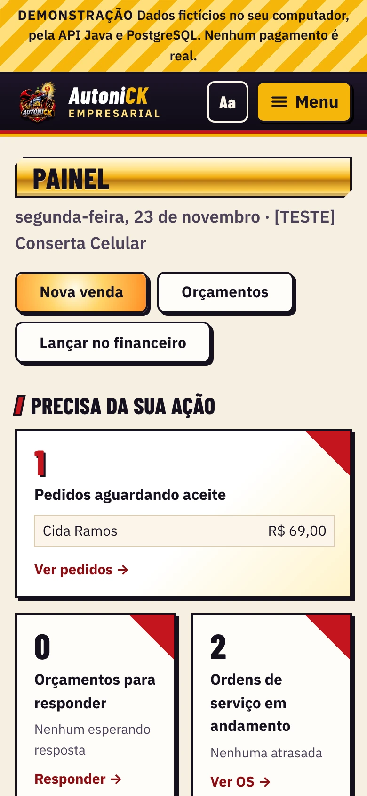
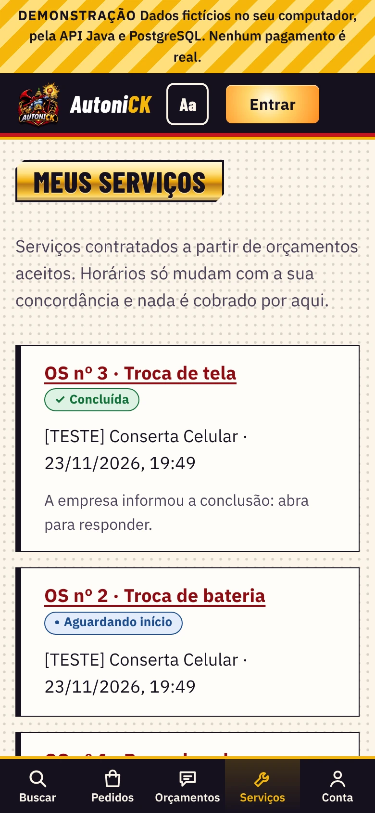

<p align="center">
  
</p>

<h1 align="center">AutoniCK</h1>

<p align="center">
  Plataforma integrada de gestão empresarial, serviços e relacionamento entre negócios e clientes.<br>
  Uma iniciativa da <strong>CK Group</strong>.
</p>

<p align="center">
  Java 21 · Spring Boot 3.5 · PostgreSQL 18 · PWA (HTML, CSS e JavaScript)
</p>

<p align="center">
  
</p>

O AutoniCK é uma aplicação web progressiva (PWA) que reúne a gestão de micro e pequenos negócios e a relação desses negócios com os seus clientes. A empresa organiza vendas, estoque, financeiro, serviços e ordens de serviço; o cliente encontra estabelecimentos, pede produtos e orçamentos e acompanha cada atendimento. A plataforma tem três áreas: **Business** (gestão da empresa), **Cliente** (descoberta e acompanhamento) e **Admin CK** (moderação e administração).

> **Situação atual:** o AutoniCK está em desenvolvimento contínuo e ainda não opera como serviço aberto ao público. Esta versão roda localmente, com dados fictícios, e não processa pagamentos reais.

## Sumário

- [O problema](#o-problema)
- [A proposta](#a-proposta)
- [Telas](#telas)
- [Funcionalidades implementadas](#funcionalidades-implementadas)
- [Tecnologias](#tecnologias)
- [Arquitetura](#arquitetura)
- [Segurança](#segurança)
- [Instalação e execução](#instalação-e-execução)
- [Contas fictícias](#contas-fictícias)
- [Testes](#testes)
- [Limitações conhecidas](#limitações-conhecidas)
- [Próximos passos](#próximos-passos)
- [Créditos e direitos](#créditos-e-direitos)

## O problema

Pequenos negócios costumam controlar vendas, estoque, contas e serviços em planilhas, cadernos e aplicativos de mensagem que não conversam entre si. Do outro lado, clientes têm dificuldade para encontrar prestadores locais, pedir um orçamento e acompanhar o andamento do serviço.

## A proposta

- **Um único registro para os dois lados:** a venda, o orçamento ou a ordem de serviço que a empresa registra é o mesmo dado que o cliente acompanha, sem cópias nem retrabalho.
- **Gestão completa num só lugar:** equipe e permissões, produtos e estoque, vendas, financeiro, serviços, agenda e ordens de serviço.
- **Descoberta local:** clientes encontram estabelecimentos por cidade, bairro e categoria, pedem produtos e orçamentos e conversam com a empresa dentro de cada atendimento.
- **Confiança e moderação:** a vitrine pública só mostra empresas aprovadas pela CK, e avaliações, denúncias e contestações passam por moderação.
- **Integridade dos dados:** regras de negócio, permissões, estoque e financeiro são garantidos pelo banco de dados, e não pela tela.

## Telas

Capturas da demonstração local, com dados fictícios. Outras telas estão em [`docs/imagens`](docs/imagens).

<table>
  <tr>
    <td width="50%"></td>
    <td width="50%"></td>
  </tr>
  <tr>
    <td><strong>Página inicial.</strong> Entrada para clientes e para negócios.</td>
    <td><strong>Produtos e estoque.</strong> Saldo disponível, físico e reservado por produto, com alerta de estoque baixo.</td>
  </tr>
  <tr>
    <td></td>
    <td></td>
  </tr>
  <tr>
    <td><strong>Ordem de serviço.</strong> Ciclo completo, do início à conclusão, com resumo em PDF.</td>
    <td><strong>Área Cliente.</strong> Serviços contratados e a situação de cada um.</td>
  </tr>
  <tr>
    <td></td>
    <td></td>
  </tr>
  <tr>
    <td><strong>Busca de estabelecimentos.</strong> Por cidade, bairro e categoria, sem posições pagas.</td>
    <td><strong>Admin CK.</strong> Aprovação, moderação, suspensão de vitrine e limites da plataforma.</td>
  </tr>
</table>

<p align="center">
  
  &nbsp;&nbsp;
  
  <br>
  <em>Layout responsivo: painel da empresa e área do cliente num celular.</em>
</p>

## Funcionalidades implementadas

**Business**
- Cadastro de empresas, mais de uma por gestor, com cartão de vitrine sujeito à aprovação da CK.
- Equipe com convites, perfis de acesso e permissões por módulo (catálogo de 55 permissões), incluindo limite de desconto por perfil.
- Produtos com variações, estoque físico, reservado e disponível, movimentações propostas e aprovadas, alertas de estoque mínimo, fornecedores e compras.
- Clientes internos, vendas de balcão, pedidos recebidos pela vitrine (aceite, recusa, conclusão) e recebimentos.
- Financeiro: contas e caixas, categorias, títulos a pagar e a receber com parcelas, pagamentos parciais, estornos, transferências, recorrências, fechamento de período e relatórios com exportação CSV.
- Serviços com orçamento manual ou por regras, solicitações, versões de orçamento e agenda.
- Ordens de serviço com ciclo completo: iniciar, pausar, retomar, informar conclusão, reabrir para revisão, encerrar, atualizações para o cliente, notas internas, garantia, materiais com reserva e baixa de estoque, sinal e parcelamento.
- Painel com o que precisa de ação, mensagens por pedido, solicitação e OS, avaliações e PDFs gerados no navegador.

**Cliente**
- Busca de empresas, produtos e serviços por cidade, bairro e categoria.
- Pedidos de produtos, solicitações de orçamento, aceite ou recusa de orçamentos.
- Acompanhamento de pedidos e OS, confirmação de recebimento, pedido de revisão, avaliação e conversa com a empresa.

**Admin CK**
- Fila de aprovação de cartões de vitrine, moderação de alterações e avaliações, contestações, denúncias e suspensão de vitrine.
- Limites da plataforma ajustáveis dentro de faixas definidas, com motivo obrigatório e histórico (por exemplo, mensagens por conversa e denúncias por dia).

**PWA**
- Instalável, com service worker que guarda só arquivos estáticos (dados privados nunca vão para o cache), página offline, leitura ampliada e layout responsivo.

## Tecnologias

| Camada | Tecnologias |
| --- | --- |
| Backend | Java 21, Spring Boot 3.5 (Web, Security, OAuth2 Resource Server, JDBC, Validation), Maven Wrapper |
| Banco de dados | PostgreSQL 18: funções PL/pgSQL, Row Level Security, permissões por coluna, 22 migrations versionadas com rollback |
| Frontend | HTML5, CSS3, JavaScript (ES Modules), Service Worker, pdf-lib, three.js |
| Testes | JUnit 5 e Spring Boot Test, `node:test`, Playwright com axe-core |
| Execução local | PostgreSQL 18 portátil (binários do projeto zonky), sem instalação e sem Docker |
| Integração contínua | GitHub Actions: job da API Java e job da PWA (unitários, banco e interface) |

## Arquitetura

```
Navegador (PWA: HTML, CSS, JS)
        │  mesma origem: /api/...
        ▼
API Java (Spring Boot)
  • valida o token e separa pessoa de visitante anônimo
  • catálogo fechado de operações por domínio
  • uma transação por pedido, com a identidade aplicada só nela
  • rotas próprias de ordens de serviço
  • traduz erros do banco, limita uso, entrega a PWA na execução local
        │  JDBC (papel da API sem acesso direto aos dados)
        ▼
PostgreSQL 18
  • funções PL/pgSQL com as regras de negócio
  • RLS e permissões por coluna
  • idempotência, versão, estoque e trilha de auditoria
```

A divisão de responsabilidades é intencional. As regras de negócio, as permissões por empresa e a integridade de estoque e financeiro ficam nas **funções do PostgreSQL**, perto dos dados e dentro da mesma transação. A **API Java** é a porta de entrada: ela autentica, decide o que pode ser chamado, aplica a identidade do usuário em cada transação, garante transações somente leitura nas consultas e devolve erros consistentes. O **frontend** só exibe e envia dados: ele nunca é a fonte de verdade de preços, permissões ou saldos.

O caminho completo de um pedido, os módulos e a organização do banco estão em [docs/arquitetura.md](docs/arquitetura.md).

### API Java

Código em `java/os-api` (módulo Maven `os-api`, pacote `br.com.ckgroup.autonick.osapi`).

- **Camada de dados por domínio** (`plataforma`). `Dominio` lista, em 11 domínios (empresas e equipe, produtos e estoque, vendas e pedidos, financeiro, serviços e orçamentos, ordens de serviço, comunicação, vitrine pública, vitrine de demonstração, identidade e Admin CK), as funções do banco que a API aceita executar. Nada fora dessa lista é executado, mesmo que exista no banco.
- **Executor de operações** (`ExecutorDados`). Lê a assinatura de cada função no catálogo do PostgreSQL, aceita só os parâmetros que ela declara, vincula os valores sempre por parâmetro JDBC com o tipo correto e confere a chave de operação nas escritas. Abre uma transação por pedido, somente leitura para funções `STABLE`, aplica `SET LOCAL ROLE` e a identidade do token com `set_config(..., true)` e define um tempo máximo por comando. No fim da transação, a conexão volta ao pool sem papel nem identidade.
- **Leitura de tabelas** (`ConsultaTabelas`). Subconjunto fechado de filtros (`eq`, `in`, `is`), seleção de colunas conferida no catálogo do banco, um relacionamento embutido e limite de linhas. Quem decide as linhas e colunas visíveis continua sendo o banco, por RLS e permissões por coluna.
- **Rotas de ordens de serviço** (`web` e `dados`). Endpoints REST próprios para listas, detalhe e escritas da empresa e do cliente (iniciar, pausar, concluir, reabrir, encerrar, atualizações, garantia, materiais, confirmação de recebimento e pedido de revisão). Antes de cada escrita, a API confere na mesma transação se a pessoa ainda pode agir sobre aquela OS.
- **Erros** (`DadosController`, `TratadorErros`). O código de regra que a função SQL coloca no `HINT` vira status HTTP e mensagem em português. Erros inesperados viram uma resposta genérica, sem SQL nem pilha.
- **Demonstração** (`demonstracao`). Contas fictícias, entrada por pessoa, montagem do cenário fictício pelas próprias funções do app e cenários isolados por visitante.

### PostgreSQL

- O schema vem das migrations em `db/migrations_propostas`, cada uma com o arquivo `.down.sql` de rollback.
- `db/tests/emulacao-neon.sql` reproduz localmente os papéis e as funções de identidade (`auth.uid()`) usados pelo provedor de autenticação, para o mesmo schema rodar num PostgreSQL comum.
- A API se conecta com um papel `LOGIN NOINHERIT` que não enxerga os dados por conta própria: ele só lê ou grava assumindo, dentro da transação, o papel `authenticated` ou `anonymous`, com a identidade do token.
- Operações de escrita recebem uma chave de operação: repetir o mesmo pedido devolve o resultado já gravado, em vez de duplicar vendas, recebimentos ou baixas de estoque. Pedidos com versão esperada recusam alterações feitas sobre dados desatualizados.
- `db/demo` contém o schema `demo_auth`, usado só pela demonstração: contas fictícias de entrada e as poucas operações administrativas da montagem do cenário, todas em funções `SECURITY DEFINER` executáveis apenas pelo papel da API.

### Frontend

```
public/
  index.html, ajuda.html, offline.html, manifest.webmanifest, service-worker.js
  cliente/  business/  ck-admin/        páginas de cada área
  css/                                  tokens, base e componentes
  js/
    config/   configuração pública (qual backend usar)
    data/     acesso a dados (cliente HTTP, uma função por operação)
    domain/   regras de exibição puras (moeda, tempo, estoque)
    features/ telas, por área e módulo
    ui/       layout, formulários, diálogos e estados
    pdf/      documentos gerados no navegador
  vendor/   pdf-lib e three.js, com as licenças
  assets/   marca, ícones, fontes e capturas do manifesto
```

A configuração pública escolhe o backend de forma explícita: `neon`, `java-local` ou `java-online`. No modo Java, as telas usam o mesmo cliente de dados, apontado para `/api/auth` e `/api/dados` na mesma origem, e as ordens de serviço usam as rotas próprias da API. Um backend desconhecido deixa o acesso desligado: nunca há volta silenciosa para outro backend nem confirmação de sucesso sem resposta do servidor.

## Segurança

- **Dois modos de token**, escolhidos por configuração. No modo `neon`, a API valida tokens EdDSA do provedor de autenticação pela JWKS, com emissor exato e validade. No modo `demo`, a própria API emite e valida tokens HMAC para contas fictícias. Em nenhum dos modos um token do outro é aceito.
- **Sessão da demonstração** em cookie `HttpOnly`, `SameSite=Lax`, restrito a `/api/auth`. O token de acesso dura 15 minutos e fica só na memória da aba. O cookie de sessão nunca é aceito como token de acesso.
- **Visitante anônimo** só chama as funções da vitrine pública. Rotas de pessoa exigem token de pessoa.
- **Isolamento entre empresas** pelas regras do banco (RLS e checagens nas funções), conferido pelos testes com gestores de empresas diferentes.
- **Painel CK** conferido duas vezes: na API, antes de chamar a função, e de novo na própria função.
- **Demonstração pública (preparada, não publicada):** entrada só pelas pessoas fictícias (e-mail e senha são recusados), um cenário próprio por visitante e isolamento fechado por padrão (uma conta sem cenário é recusada). Há também limite de criação de cenários por origem e no total, e limite de operações por minuto.
- **Por padrão a API só aceita PostgreSQL local.** Um banco remoto exige configuração explícita e o modo de demonstração.
- **Cabeçalhos de segurança:** Content Security Policy restritiva (sem scripts ou estilos inline), `frame-ancestors 'none'`, `nosniff`, `Referrer-Policy` e `Permissions-Policy`.
- **Sem segredos no repositório:** a configuração da execução local é gerada a cada início, com senha aleatória para o papel da API.

## Instalação e execução

**Requisito:** JDK 21 (por exemplo, Eclipse Temurin) com `JAVA_HOME` definido. O JDK 21 é a versão-alvo do projeto. Na primeira execução é preciso internet, para baixar as dependências. Não é preciso instalar PostgreSQL, Maven, Node.js nem Docker para usar a demonstração.

Passo a passo para Windows 10 e 11, com solução de problemas: [docs/testar-no-windows.md](docs/testar-no-windows.md).

**Windows**
```bat
AutoniCK-local.cmd
```
Também é possível dar dois cliques no arquivo.

**Linux ou macOS** (com um usuário comum, porque o PostgreSQL não roda como root)
```bash
./autonick-local.sh
```

O inicializador:
1. sobe um PostgreSQL 18 portátil, só em `127.0.0.1`, numa pasta da demonstração (`%LOCALAPPDATA%\AutoniCK\demonstracao-local` no Windows, `~/.autonick/demonstracao-local` nos outros sistemas);
2. cria o banco e aplica as migrations;
3. sobe a API Java, que monta o cenário fictício na primeira execução e entrega a PWA;
4. abre o navegador em `http://127.0.0.1:8080`.

Na primeira execução, o Maven baixa as dependências e os binários do PostgreSQL, então a abertura demora mais. Os dados ficam guardados entre execuções. Para voltar ao cenário inicial:

```bat
AutoniCK-restaurar.cmd
```
No Linux ou macOS: `./autonick-local.sh --restaurar`.

Variáveis opcionais: `AUTONICK_LOCAL_PORTA` (padrão 8080), `AUTONICK_LOCAL_PASTA` e `AUTONICK_DEMO_ABRIR_NAVEGADOR=0`.

## Contas fictícias

O cenário fictício é montado pela própria API, chamando as mesmas funções que as telas usam. São quatro empresas de setores diferentes (assistência técnica, doceria, serviços elétricos e ateliê de costura), com produtos, estoque, vendas, contas a pagar, pedidos, orçamentos, ordens de serviço em vários estados, avaliação e mensagens.

Na página inicial, entre em **Cliente** ou **Business** e escolha uma pessoa em **Entrar na demonstração**. Também é possível usar o formulário de entrada com o e-mail da pessoa e a senha `demo1234`. Todos os endereços usam o domínio reservado `autonick-teste.example`, que não recebe e-mails.

| Pessoa | Área | E-mail | O que mostra |
| --- | --- | --- | --- |
| Cida Ramos | Cliente | `cliente@autonick-teste.example` | Pedidos, orçamentos, OS em vários estados, avaliação e mensagens |
| Marcos Lima | Cliente | `cliente2@autonick-teste.example` | Pedido aguardando aceite e OS em execução |
| Rafael Souza | Business | `gestor@autonick-teste.example` | Gestor da assistência técnica: vendas, estoque, financeiro e OS |
| Bianca Alves | Business | `funcionario@autonick-teste.example` | Funcionária com perfil limitado: vê vendas, não vê financeiro nem equipe |
| Rosa Martins | Business | `gestora-loja@autonick-teste.example` | Gestora de uma doceria: pedidos, estoque e vendas |
| Paulo Nunes | Business | `gestor-servicos@autonick-teste.example` | Gestor de uma prestadora de serviços elétricos: orçamentos e agenda |
| Lia Costa | Business | `gestora-atelie@autonick-teste.example` | Gestora de um ateliê de costura |
| Administração CK | Business | `ck@autonick-teste.example` | Painel CK: aprovação, moderação, contestações e limites |

Para os módulos da empresa, escolha a empresa em "Minhas empresas". Sugestões de roteiro:
- Como Rafael, abra uma OS "Aguardando início" e inicie; registre uma venda e veja o estoque baixar.
- Como Cida, peça um orçamento à elétrica; depois, como Paulo, responda a solicitação.
- Como Bianca, confira o que o perfil limitado permite e o que é recusado.

## Testes

Requisitos: Node.js 20 ou superior e `npm ci`. Os testes de banco precisam dos binários do PostgreSQL 18 (`PG_BIN`), e os testes Java de um PostgreSQL local (`AUTONICK_JAVA_DB_URL`) ou de Docker. Nenhum teste acessa serviços em nuvem: os testes de interface simulam as respostas da API, e os de banco e Java usam bancos locais descartáveis.

```bash
npm ci
npx playwright install chromium

npm run test:unit                                   # unitários do frontend
PG_BIN=/caminho/postgresql/18/bin npm run test:db   # banco: um cluster temporário por arquivo
npm run test:e2e                                    # interface (Playwright)

cd java/os-api
AUTONICK_JAVA_DB_URL=jdbc:postgresql://localhost:5432/postgres \
AUTONICK_JAVA_DB_USUARIO=postgres ./mvnw verify     # API Java
```

| Suíte | O que cobre | Última execução local |
| --- | --- | --- |
| Unitários | Regras do frontend, cliente HTTP, seleção do backend, política de segurança estática e integridade da marca | 141 aprovados |
| Banco | Cada migration e as funções SQL, inclusive rollback | 242 aprovados |
| Interface | Telas das três áreas, acessibilidade (axe-core), responsividade, PWA e PDFs | 340 aprovados |
| API Java | Rotas e escritas de OS, rollback e atomicidade, pool, tokens, isolamento entre empresas e entre visitantes | 127 aprovados |

Os números acima vêm da execução local mais recente, em Linux com JDK 21 e PostgreSQL 18. O workflow `.github/workflows/ci.yml` tem dois jobs (API Java e PWA), roda em envios e pull requests e pode ser iniciado manualmente; neste repositório ele ainda não foi executado.

## Limitações conhecidas

- Versão em desenvolvimento contínuo, executada localmente com dados fictícios. Ainda não há serviço em produção, contas reais nem pagamentos reais.
- A demonstração pública está preparada no código, mas não publicada, e a hospedagem ainda não foi escolhida.
- **Windows:** o inicializador `AutoniCK-local.cmd` foi executado manualmente num computador com Windows usando o **JDK 27**. A página inicial abriu em `http://127.0.0.1:8080`, com a identidade visual, e os quatro perfis fictícios (Cliente, Gestor, Funcionária e CK Admin) foram acessados e explorados, sem problemas relatados. Foi uma exploração manual, não uma regressão completa. A suíte automatizada usa o JDK 21; não há garantia de compatibilidade com outras versões do Java além das que foram efetivamente usadas.
- WebKit/Safari, instalação da PWA em aparelhos reais e leitores de tela ainda não tiveram validação manual completa.
- Uploads de imagens e arquivos não estão implementados.
- Na demonstração pública, o limite de cenários por origem confia no cabeçalho `X-Forwarded-For` repassado pelo proxy à frente da API, e os limites de uso ficam em memória, por instância.
- Sair da demonstração apaga o cookie, mas a sessão emitida continua válida até expirar, em até 8 horas.
- Ordens de serviço sem responsável aparecem na lista como "responsável: Pessoa sem nome".
- Na execução local, a faixa de aviso da página inicial ainda mostra o texto da versão de desenvolvimento, enquanto as demais páginas mostram a faixa da demonstração.

## Próximos passos

O AutoniCK segue em desenvolvimento. Entre as evoluções previstas está tornar configuráveis pelo painel Admin CK algumas regras e alguns limites que hoje são fixos; os parâmetros ainda serão definidos.

## Créditos e direitos

AutoniCK é uma iniciativa da **CK Group**. O nome, a marca, os logotipos e a identidade visual do AutoniCK e da CK Group pertencem aos seus titulares e não estão licenciados para reutilização. Este repositório não tem uma licença de código aberto: todos os direitos sobre o código e o conteúdo próprios são reservados.

Componentes de terceiros, com as licenças incluídas no repositório:
- **pdf-lib** (MIT), em `public/vendor/pdf-lib`;
- **three.js** (MIT), em `public/vendor/three`;
- fontes **Atkinson Hyperlegible**, **Barlow Condensed** e **IBM Plex** (SIL Open Font License 1.1), em `public/assets/fonts`;
- dependências Java (Spring Boot, PostgreSQL JDBC, Nimbus JOSE + JWT, zonky embedded-postgres, entre outras) e de teste em JavaScript (Playwright, axe-core, pdf.js), obtidas pelos gerenciadores de pacote sob as licenças de cada projeto.
